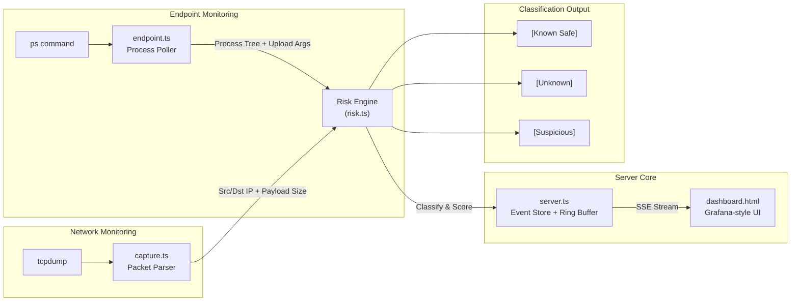

# Binary Upload Tracker

**Real-time outbound upload monitoring for macOS & Linux.**

A lightweight, zero-dependency security tool that correlates network traffic with endpoint process trees to detect and classify suspicious file uploads. Built for security analysts, SREs, and developers who need visibility into what's leaving their machines.

## Features

- **Upload-Only Filtering** — Ignores downloads and benign traffic; flags only actual upload indicators (`curl -T`, `scp`, `rsync`, `wget --post-file`, etc.)
- **Deep Process Ancestry** — Full PID/PPID chain reconstruction traces uploads back to the initiating shell or service (`bash → python → curl`)
- **Risk Engine** — Automatic classification into `known_safe`, `unknown`, and `suspicious` with explainable risk factors
- **Grafana-Style Dashboard** — Real-time web UI with event timeline, destination IP heatmap, process frequency charts, and risk donut
- **Network + Endpoint Correlation** — Combines `tcpdump` packet capture with process polling for complete visibility
- **Cross-Platform POSIX** — Native support for macOS (darwin) and Linux with automatic interface detection
- **Zero Dependencies** — Single-runtime [Bun](https://bun.sh/) application, no npm packages required


## Dashboard


## Architecture



### How It Works

1. **Network Capture** — `capture.ts` spawns `tcpdump` on the active interface and parses each TCP line into structured `NetworkEvent` objects containing timestamp, source/destination IPs, port, and payload size. Only HTTP ports (80, 443, 8080, 8443) are monitored.

2. **Endpoint Polling** — `endpoint.ts` polls the process table every second via `ps`, matches upload indicators against command lines, and builds full process ancestry trees by walking the PID→PPID chain upward until reaching PID 1 or an orphaned process.

3. **Risk Assessment** — Every event passes through `risk.ts` before being stored. The Risk Engine evaluates multiple signals (destination IP, binary location, process ancestry, payload size, obfuscation patterns) and assigns a classification + risk score + human-readable risk factors.

4. **Live Streaming** — `server.ts` merges both event streams into a 500-event ring buffer, computes live statistics, and broadcasts classified events via Server-Sent Events (SSE) to all connected dashboard clients.

### Upload Detection Patterns

| Tool | Flagged Patterns | Ignored |
|------|-----------------|---------|
| `curl` | `-T`, `--upload-file`, `-F`, `-X PUT`, `-d @file` | GET requests, `-o` output |
| `wget` | `--post-file`, `--body-file`, `--method=PUT` | Standard downloads |
| `nc`/`ncat` | Stdin redirect (`< file`) | Port scanning (`-zv`) |
| Interpreters | `upload`/`exfil` keywords, script filenames | Normal execution |
| `scp`/`sftp`/`rsync`/`ftp` | **Always flagged** | — |

## Risk Engine & Segmentation

The Risk Engine is the core intelligence layer. Every captured event is evaluated against multiple heuristics and assigned one of three classifications:

### Classification Levels

| Classification | Indicator | Description | Typical Score |
|---------------|-------|-------------|---------------|
| `known_safe` | [Known Safe] | Standard system binaries communicating over local networks or well-known ports | 0–15 |
| `unknown` | [Unknown] | User-space scripts, interpreters, or public internet destinations that don't match known-safe or suspicious patterns | 30–60 |
| `suspicious` | [Suspicious] | Execution from temp directories, non-standard ports, obfuscated commands, or large payloads to public IPs | 70–100 |

### Risk Factors

Each classified event includes an array of **Risk Factor** tags that explain *why* the engine made its decision. These give analysts immediate context without digging through raw logs:

| Risk Factor | Trigger | Example Scenario |
|------------|---------|-----------------|
| `LOCAL_NETWORK` | Destination IP is RFC1918 private range | Internal API call to `192.168.1.50` |
| `PUBLIC_INTERNET` | Non-private destination on standard port | `curl -T` to `93.184.216.34:443` |
| `NON_STANDARD_PORT` | Public destination on high/unusual port | Upload to `example.com:9443` |
| `USER_SPACE_BINARY` | Executable lives under `~/` or `/Users/` | Script running from home directory |
| `TMP_EXECUTION` | Binary or script executed from `/tmp/` or `/var/tmp/` | Dropper executing staged payload |
| `INTERPRETER_EXECUTION` | Python/Node/Bash/etc. detected in process tree | `python3 exfil_script.py` |
| `OBFUSCATED_COMMAND` | Base64, eval(), exec(), or long encoded strings | `bash -c 'echo BASE64... \| base64 -d \| sh'` |
| `LARGE_RAW_PAYLOAD` | >10 KB payload to non-private destination | Bulk data transfer without TLS context |
| `MASSIVE_UPLOAD` | File size exceeds 10 MB | Database dump or archive exfiltration |
| `SYSTEM_BINARY` | Binary located in `/usr/bin/`, `/bin/`, etc. | Standard `curl` or `scp` from system path |

### Known vs. Unknown vs. Suspicious

- **Known Safe** — The binary originates from a trusted system directory (`/usr/bin/`, `/System/`, `/opt/homebrew/bin/`) AND communicates over a private network or standard port. These are routine operations like package manager updates or internal service calls.

- **Unknown** — The event doesn't clearly fit safe or suspicious categories. Common examples: interpreter scripts running from user directories, `curl` uploads to public HTTPS endpoints, or processes with incomplete ancestry. These warrant investigation but aren't inherently malicious.

- **Suspicious** — Multiple risk signals converge: execution from temporary directories, obfuscated command arguments, non-standard ports to public IPs, or unusually large payloads. These represent potential data exfiltration or C2 communication and should be triaged immediately.

## Installation & Usage

### Prerequisites

- [Bun](https://bun.sh/) v1.0+
- Root privileges (`sudo`) — required for `tcpdump` packet capture
- macOS or Linux

### Quick Start

```bash
git clone https://github.com/osumtr-web/binary-upload-tracker.git
cd binary-upload-tracker
sudo bash run.sh
```

Open **http://127.0.0.1:3777** in your browser to access the dashboard.

### Custom Network Interface

```bash
sudo bash run.sh --interface eth0
```

### Environment Variables

| Variable | Default | Description |
|----------|---------|-------------|
| `MIN_BYTES` | `64` | Minimum payload size (bytes) to trigger a network event |
| `BUT_INTERFACE` | auto-detect | Override default network interface |

## Testing

```bash
bun test
```

Tests cover upload indicator matching, file path extraction, and tcpdump line parsing across edge cases including case insensitivity, dedicated transfer tools, interpreter keywords, and stdin redirects.

## Project Structure

```
run.sh          → Entry point (ensures root, launches server)
server.ts       → HTTP/SSE server, ring buffer event store, dashboard serving
capture.ts      → tcpdump subprocess management, TCP line parsing, interface detection
endpoint.ts     → Process poller, upload indicator matching, ancestry tree building
risk.ts         → Risk Engine: classification, scoring, risk factor generation
dashboard.html  → Self-contained Grafana-style monitoring UI
tests/          → Unit tests for capture parsing and upload detection
```

## License

MIT © 2026 osumtr-web